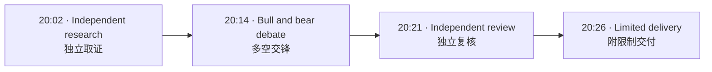
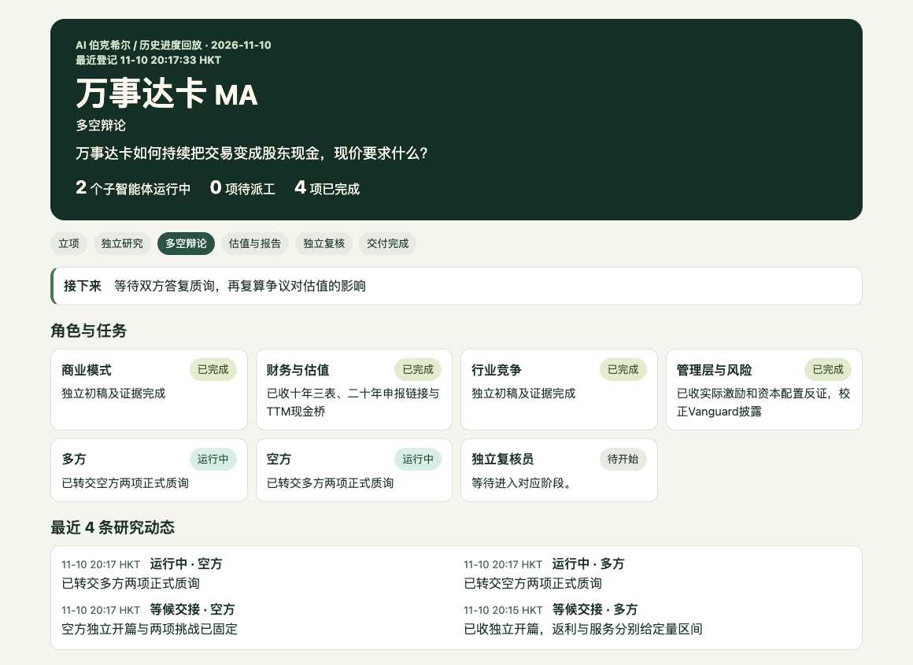

# AI Berkshire · AI 伯克希尔

[English](#english) · [简体中文](#简体中文) · [Mastercard case / 万事达卡案例](#mastercard--万事达卡) · [Install / 安装](#install--安装)

**From how a company makes money to what would change your valuation.**

**从公司怎么赚钱，到哪些证据会改变估值。**

## English

**Berkshire Team 2.2.13** runs fundamental company research in Codex. Four researchers independently cover business and moat, financials and valuation, industry and competition, and management and risk. Two debaters test the investment case. A separate reviewer checks the evidence, model, and strongest counterargument. **AI Value Investing Agents (AIVA) 1.2.2** adds analytical and writing guidance within the same team when enabled. Berkshire Library indexes investment materials in your workspace.

> **Try a full study:** Use Berkshire Team to research Mastercard (MA). Explain how it earns money, test the most consequential valuation assumptions, and show what evidence would change your view.
>
> **Try a focused question:** How does Mastercard make money? Cite your sources.

### Follow the research

| Stage | What you can inspect |
|---|---|
| **Understand the company** | Its history, ownership, management and operations. Who pays, what they buy, why they return, and what it costs to grow. |
| **Reconstruct the financial record** | A ten-year target with original filing links where available. Periods, currencies, units, accounting changes and missing figures are explicit. |
| **Challenge the thesis** | Four independent research notes, verbatim bull/bear questions and answers, and the evidence that changed each position. The local dashboard updates as work is recorded. |
| **Value and review** | A bridge from earnings to cash available to shareholders, suitable methods such as DCF and sum-of-the-parts, and controlled tests of disputed assumptions. Independent review supports a delivery status of complete, limited, or blocked. External analyst views come after the team's own valuation and are labeled as full reports, public summaries, or rating actions. |

English and Chinese requests use the same scope, evidence standards, six-part report structure, valuation and review. The requested language carries through to the debaters and reviewer. A company overview or earnings recap can run on its own.

### What's new

LangGraph dispatches the live debate, waits for both opening cases before sharing them, and forwards each side's original questions after both submit. It can retrieve evidence from registered files and return a specific issue to the original debater for revision. Saved checkpoints support replay and resumption. [Live debate setup](plugins/berkshire-team/skills/berkshire-team/references/langgraph-debate.md)

The local learning workflow records a baseline answer, source reading, teacher feedback, revision, and an independently graded retest. The source material and results stay in your workspace. [Learning workflow](plugins/berkshire-team/skills/berkshire-team/references/langgraph-learning.md) · [American Water blind test](docs/examples/american-water-blind-test.md) · [Blind-test comparison](docs/examples/principle-card-blind-tests.md)

## 简体中文

**伯克希尔团队 2.2.13** 在 Codex 中做公司基本面研究。四位研究员分别独立分析商业模式与护城河、财务与估值、行业与竞争、管理层与风险。两位辩手检验投资逻辑，再由独立复核员核查证据、模型和最强反证。启用 **AI Value Investing Agents（AIVA）1.2.2** 后，同一团队会采用它的分析与写作方法。伯克希尔资料库可为你工作区中的投资资料建立索引。

> **试做完整研究**　用伯克希尔团队研究万事达卡（MA）。说明它怎么赚钱，检验最影响估值的假设，写清什么证据会让你改判。
>
> **试问一个专项问题**　万事达卡怎么赚钱？请附上来源。

### 跟着研究读

| 阶段 | 可以看到什么 |
|---|---|
| **读懂公司** | 发展历史、股权、管理层和业务。谁付钱、买什么、为什么继续买，以及业务增长需要付出什么成本。 |
| **还原长期财务** | 尽量整理十年数据，附可取得的原始财报链接，注明期间、币种、单位、口径变化和数据缺口。 |
| **质疑投资逻辑** | 四份独立研究底稿、多空原始问答、哪些证据促使双方改判。本地面板随研究记录更新。 |
| **估值并复核** | 从利润到股东可得现金的推导，适用的现金流折现或分部估值，以及对争议假设的单变量检验。独立复核后区分完整交付、附限制可用和受阻。团队先形成自己的估值，最后参考外部机构，并区分研报全文、公开摘要和评级行动。 |

中英文提问共用任务范围、取证标准、六部分报告结构、估值和复核。用户指定的语言会传给辩手和复核员。只问公司概况或财报复盘时，可以走对应专项流程。

### 这版增加了什么

LangGraph 接管正式多空调度，双方交齐开篇后才互看原文，交齐质询后再转发原始问题。它可从已登记文件补证，把复核员退回的具体问题交给原辩手修订，并通过检查点回放或续跑。[正式辩论配置](plugins/berkshire-team/skills/berkshire-team/references/langgraph-debate.md)

本地资料学习流程记录初答、原文阅读、老师批改、修订和独立同题验收。资料和结果保存在你的工作区。[资料学习流程](plugins/berkshire-team/skills/berkshire-team/references/langgraph-learning.md) · [美国水务盲评](docs/examples/american-water-blind-test.md) · [盲评总表](docs/examples/principle-card-blind-tests.md)

## Mastercard / 万事达卡

This completed local run used version 2.2.8 of Berkshire Team on **10 November 2026**, Hong Kong time. The panel recorded 27 events. The screenshot replays cross-examination at **20:17:33**, after both opening cases were filed and before independent review.

这轮实跑于 **2026 年 11 月 10 日**在本地 2.2.8 完成，时间均为香港时间。面板记录了 27 条事件。截图回放 **20:17:33** 的质询阶段，当时双方已提交开篇，独立复核尚未开始。



<details>
<summary>See the research dashboard / 展开研究面板</summary>



</details>

| What changed in debate / 质询后怎么改判 | Base → stress DCF (USD/share) / 基准至压力估值（美元/股） |
|---|---:|
| **Year-five network rebate rate / 第五年网络返利率.** Capital One's partial migration did not support a global rebate rate of 57%. Apple Card contract terms were unavailable, so the test held volume fixed. / Capital One 局部交易迁移不足以支持全球返利率升至 57%。Apple Card 合同条款未知，测试保持交易量不变。 | 54.5% → 57%<br/>$468.28 → $465.67 |
| **Year-one value-added services net revenue growth / 首年增值服务净收入增速.** The bear found insufficient product or customer disclosure for 11%. The team kept 15% as a conditional base and tracked cash conversion separately. / 产品与客户披露不足以支持 11%。团队有条件保留 15% 基准，另行跟踪现金兑现。 | 15% → 11%<br/>$468.28 → $460.46 |

The reviewer checked 13 groups of facts and independently recomputed 438 calculations, all of which passed. The result was **LIMITED** to a group-level conditional valuation because the standalone services margin was unavailable.

复核员抽查 13 组事实，独立复算 438 项，全部通过。因缺少增值服务独立利润率，交付判为 **LIMITED（附限制可用）**，适用于集团层面的条件估值。

## Install / 安装

```sh
codex plugin marketplace add goldmansachs687-ctrl/ai-berkshire-codex
codex plugin add berkshire-team@berkshire-community
```

Already using the marketplace? Run `codex plugin marketplace upgrade berkshire-community`, then rerun the install command. For joint mode, also install `ai-value-investing-agents@berkshire-community`. Open a new Codex session after installing. The desktop plugin directory lists **AI 伯克希尔 · 社区版**. [Official OpenAI installation guide](https://developers.openai.com/plugins/build/plugins#install-a-local-plugin-manually)

已添加市场的用户先运行 `codex plugin marketplace upgrade berkshire-community`，再重新执行安装命令。使用联合模式时，同时安装 `ai-value-investing-agents@berkshire-community`。安装后开启新的 Codex 会话，也可以在桌面插件目录选择 **AI 伯克希尔 · 社区版**。[OpenAI 官方安装文档](https://developers.openai.com/plugins/build/plugins#install-a-local-plugin-manually)

Full studies require internet access and subagent support. Live LangGraph debate requires Python 3.12, pinned dependencies, and a signed-in Codex CLI. Core evidence checks use the Python standard library. Market and earnings integrations use available and authorized data sources. [Plugin details](plugins/berkshire-team/README.md) · [Joint mode](plugins/berkshire-team/skills/berkshire-team/references/joint-mode.md)

完整研究需要联网和子代理能力。LangGraph 正式辩论需要 Python 3.12、固定版本依赖和已登录的 Codex CLI。基础证据核验使用 Python 标准库，行情和财报功能使用可用且已授权的数据源。[插件详情](plugins/berkshire-team/README.md) · [联合模式](plugins/berkshire-team/skills/berkshire-team/references/joint-mode.md)

## Verification / 验证

```sh
python3 -m pip install -r requirements-ci.txt
python3 scripts/check_plugins.py
python3 scripts/run_tests.py
```

The offline suite verifies configurations, evidence and delivery rules, and workflow mechanics. See the Actions run for the published revision. [Delivery acceptance](docs/delivery-acceptance.md)

离线测试覆盖配置、证据与交付规则、工作流机制。发布版本的结果可在 Actions 查看。[交付验收](docs/delivery-acceptance.md)

## Data and licensing / 数据与许可

Research outputs and library records are stored in your workspace. Follow each provider's data terms. Report vulnerabilities privately through GitHub and use Issues for ordinary feedback. The community edition derives from AI Berkshire and AI Value Investing Agents and is unaffiliated with Berkshire Hathaway. It is for research and education. [Security policy](SECURITY.md) · [MIT license](LICENSE) · [Upstream credits and third-party notices](NOTICE.md)

报告和资料库记录保存在工作区。使用数据时遵守各提供方条款。漏洞请在 GitHub 私密提交，普通反馈可用 Issues。本社区版源自 AI Berkshire 和 AI Value Investing Agents，与伯克希尔哈撒韦无隶属关系，供研究与学习使用。[安全说明](SECURITY.md) · [MIT 许可证](LICENSE) · [上游和第三方声明](NOTICE.md)
